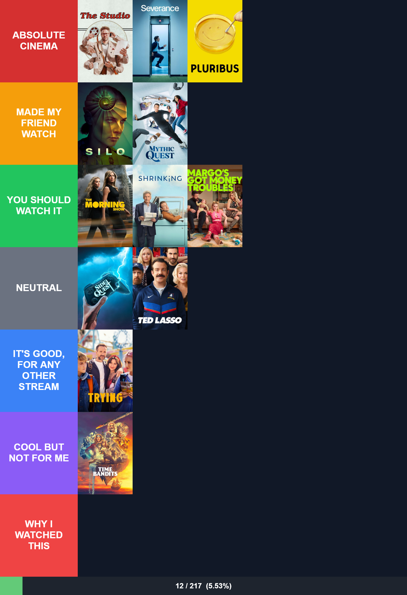

# Apple TV+ Tier List

Rank every Apple TV+ show and movie you have watched. No backend, no account, no database.
Everything lives in your browser.



## Why this exists

Apple TV+ has a small enough catalog that you can actually watch (and rank) most of it. This app
gives you two tier lists, one for series and one for movies, pre-loaded with the full catalog so
you can search and drop a title into a tier in a couple of clicks.

## Features

- Full Apple TV+ catalog (series and movies) bundled with posters, so search is instant and works
  offline.
- Drag-free ranking: search a title, pick a tier from a dropdown, done.
- Hover a poster to move it up, move it down, or remove it.
- Tier names and colors are editable.
- A progress bar shows how much of the catalog you have actually watched.
- Everything is saved to `localStorage`. Nothing leaves your browser unless you choose to share it.
- A compact share code lets you back up your tier list or hand it to someone else, no server
  involved.
- Download the current tier list as a PNG, from the UI or from a script (see [AGENTS.md](AGENTS.md)
  for driving it headlessly).

## Getting started

```bash
bun install
cp .env.example .env
bun run build
bun run dev
```

Fill `.env` with your TMDB API read access token (themoviedb.org, Settings, API). The build
inlines it into the bundle for the live search, and `build:catalog` uses it to fetch the catalog.

Open `http://localhost:4173/series.html` or `http://localhost:4173/movies.html`.

## Rebuilding the catalog

The catalog and posters in `data/` and `posters/` are generated from
[TMDB](https://www.themoviedb.org/) (Apple TV+ availability for the BR region). To refresh them:

```bash
bun run build:catalog
```

Searching for a title that isn't in the catalog yet also works straight from the UI: if nothing
matches locally, the search box falls back to a live TMDB search.

## Building for production

```bash
bun run build
```

This bundles the app, downlevels the output to ES5 with `core-js` polyfills, and compiles the
SCSS. The result is a handful of static files: open `series.html` or `movies.html` directly, or
serve the repo root with any static file server.

## Testing

```bash
bun run test       # unit tests (bun:test)
bun run test:e2e   # Playwright, covers the full user flow
```

## Project layout

```
src/tierlist/   domain logic: catalog, tier state, actions, share codes
src/render/     canvas rendering shared by the download button and the CLI
src/ui/         DOM components (search, tier rows, cards, share controls)
src/app/        page bootstrapping and the window.Tierlist agent API
scripts/        catalog build, dev server, headless render CLI
data/, posters/ generated catalog and images
tests/e2e/      Playwright suite
```

## License

MIT, see [LICENSE](LICENSE).
